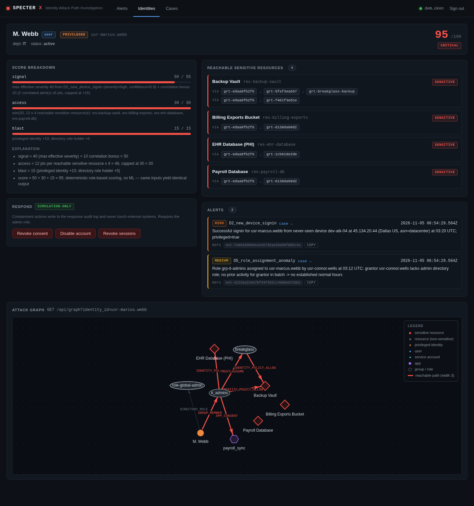
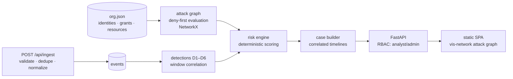

# SPECTER X — Cloud Identity Attack-Path Analysis & Autonomous Investigation

[](https://github.com/TexasSlammer/specter-x/actions/workflows/ci.yml)


Most identity tools show you alerts. SPECTER X shows you **why an identity is dangerous**: it maps how a compromised account can actually reach sensitive resources — through group membership, role-assumption chains, OAuth consent delegation, or resource policies — then correlates suspicious behavior with that reachability into an evidence-backed investigation.



*(All data is a synthetic fictional org — `datasets/provenance.json`. The panel above is computed, not mocked: risk score, reachable resources, and grant-id evidence chains come from the engine at request time.)*

## Measured results (reproduce with `python benchmarks/evaluation.py`)

| Acceptance target | Result | Evidence |
|---|---|---|
| Known permission paths found | **7/7** | `benchmarks/results/evaluation.json` → `permission_fixtures` |
| Explicitly denied paths rejected (with correct reason) | **5/5** | same |
| Labeled attack scenarios detected | **4/4** | MFA fatigue, OAuth consent abuse, service-account takeover, impossible travel, role-grant abuse |
| False alerts on 288 normal events | **0** (FP rate 0.0000) | baseline regression test runs in CI |
| Repeated ingestion duplicates | **0** (288/288 replay → 288 rows) | idempotency by `event_id` |
| Scenario replay duplicates alerts | **0** | content-addressed alert ids — re-running a scenario cannot double-count |
| API authz matrix (401/403) | **5/5** | `backend/tests/integration/test_api.py` |
| Alert→event traceability | **100%** (18/18 refs across 10 alerts) | every finding cites `event_id`s |
| API latency (p95) | 15.2 ms identities / 10.0 ms identity detail | local SQLite, 60-sample measurement |
| Ingestion load | 10k: 6,578 ev/s · 100k: 6,158 ev/s · **1M: 5,797 ev/s** (172 s, 3.0 GB RSS) | `benchmarks/results/load_test.json` |

Backend test suite: **94 tests passing** — 33 attack-graph fixtures, 32 detection/scoring, 14 integration/authz, 5 adversarial FP-resistance, 10 e2e user-journey. CI runs the tests on Python 3.10 and 3.12, then re-executes every measurement above and fails the build on regression.

## What it does

1. **Ingests** Entra-style sign-ins, CloudTrail-style API calls, and OAuth consent events; validates, deduplicates (`event_id` is the idempotency key), and normalizes them.
2. **Builds the permission graph** — users, groups (nested, depth ≤ 5), service principals, roles, OAuth apps, resources — and evaluates reachability with AWS-style **deny-overrides-allow** semantics, condition checks (IP / time window / ASN type), trust-policy chains (≤ 5 hops), and consent-to-resource scope mapping. Denied paths are returned with the *reason* (`explicit_deny`, `condition_mismatch`, `no_allow_path`, `trust_mismatch`) — never silently dropped.
3. **Detects** MFA fatigue, first-seen device on privileged identities / datacenter ASNs, impossible travel (suppressed under VPN/mobile — GeoIP uncertainty is a documented FP rule), risky OAuth consent, anomalous role assignments, and interactive service-account logins.
4. **Scores** each identity 0–100 with a deterministic, explainable model: behavior signals + blast radius from *reachable* sensitive resources — a suspicious sign-in on a privileged identity that can touch the EHR database outranks the same behavior on a demo account.
5. **Investigates** — alert queue, identity risk breakdowns, interactive attack graph (path edges highlighted), correlated case timelines where every item cites its `event_id`, JSON export.
6. **Responds (simulation only)** — consent revoke / account disable / session revoke behind an admin-only gate with a full audit trail. The demo never touches an external system.

## Quickstart (no Docker needed)

```bash
git clone https://github.com/TexasSlammer/specter-x && cd specter-x
python -m venv .venv && source .venv/bin/activate     # Windows: .venv\Scripts\activate
pip install -r requirements.txt
cd backend && uvicorn app.main:app
```

Open http://127.0.0.1:8000 — the server auto-loads the Northstar Health dataset on first boot (29 identities, 45 grants, 305 events, 4 labeled attacks).

| Demo token | Role |
|---|---|
| `demo-analyst-token` | read + ingest + evaluate |
| `demo-admin-token` | everything + simulated response actions |

Or with Docker: `docker compose up --build` → same URL.

## Architecture



The permission-graph engine is the star: `backend/app/attack_graph/permission_eval.py` documents the full authorization reasoning (why deny wins, how conditions bind, why multi-route joins fail closed). Read `CONTRACTS.md` for the complete engineering contract — it is the single source of truth the code is held to.

## The dataset

`datasets/generator.py` builds **Northstar Health** deterministically (seed 42): 29 identities, 45 grants, 8 resources, two weeks of normal activity, and four labeled attack scenarios with ground truth (12 labeled paths, expected detections, minimum scores). Regenerating is byte-identical — provenance in `datasets/provenance.json`. All identities are fictional.

## Validation

- `cd backend && python -m pytest tests -q` — 94 tests: unit fixtures, integration authz/idempotency, adversarial FP-resistance (VPN "impossible travel", verified-app consent, in-hours admin role grants must stay silent), and a 10-step e2e recruiter journey
- `python benchmarks/evaluation.py` — re-writes the measured-results table above; exits non-zero on any regression
- `python benchmarks/load_test.py --full` — 10k / 100k / 1M-event ingestion benchmark

Detailed write-ups: [docs/architecture.md](docs/architecture.md) · [docs/detection-methodology.md](docs/detection-methodology.md) · [docs/threat-model.md](docs/threat-model.md) · [docs/limitations.md](docs/limitations.md) · [docs/findings.md](docs/findings.md)

## Honest scope

Cloud authorization coverage is a **documented subset** (identity/resource/trust policies, group nesting, consent scopes, conditions) — not all of Entra Conditional Access or AWS ABAC. Auth is demo-grade env tokens. Response actions are simulations. The full list is in [docs/limitations.md](docs/limitations.md); the interesting engineering failures and fixes are in [docs/findings.md](docs/findings.md).

---

Part of a security portfolio: [ct-watcher](https://github.com/TexasSlammer/ct-watcher) (CT-log phishing detection) · [detection-range](https://github.com/TexasSlammer/detection-range) (AD detection lab with real Atomic Red Team validation) · [mcp-testbed](https://github.com/TexasSlammer/mcp-testbed) (MCP agent security)

MIT License.
