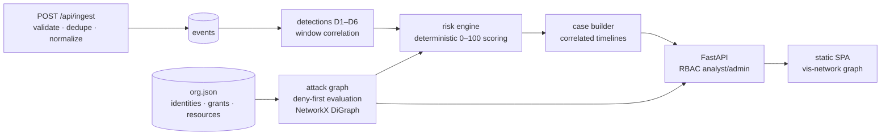

# Architecture

## Components

## Data flow (`POST /api/evaluate`, the demo driver)

1. Scenario events load from `datasets/attack-scenarios/*.jsonl` and pass through the same ingestion path as live data: per-event validation (source/type whitelist, required fields, RFC3339 timestamps), then idempotent storage keyed by `event_id`. Replays are counted as `duplicates`, never stored twice.
2. `run_all_detections` sorts by timestamp and runs D1–D6 as pure functions over the event list plus a ctx (identity metadata, city coordinates, privileged-group list).
3. Persisted alerts are correlated into cases (`investigations/cases.py`): alerts sharing an identity merge into one case whose timeline interleaves the underlying events, each item carrying its `event_id`/`alert_id`.
4. For every compromised identity, `find_reachable_sensitive_resources` evaluates the graph (deny-first, condition-aware) and `score_identity` combines behavior + blast radius into the 0–100 score with per-component justifications.

## Storage

SQLAlchemy 2.x over SQLite (default file `specter.db`) or Postgres (`DATABASE_URL`). JSON columns hold event attributes and grant conditions. All security findings keep `event_refs` so 100% traceability is enforced by tests, not conventions.

## Why NetworkX, not Neo4j

The org graph here is 49 nodes / 45 edges. An in-process NetworkX DiGraph answers reachability in microseconds with zero operational footprint — a graph database would add a service, a query language, and ops burden to solve a problem this dataset does not have. The ceiling is real and stated: enterprise directories (10⁵–10⁶ nodes) need a persistent graph store or bounded subgraph extraction. Ingestion — the load-bearing path — is measured independently up to 1M events (`benchmarks/results/load_test.json`: ~5.6k events/s sustained); graph traversal beyond the seed org is not benchmarked and is listed in `limitations.md`.

## Why SQLite-default

The acceptance bar is "fresh clone → working investigation in one command". SQLite does that with zero setup; the Postgres switch is one env var and exercised by the Docker Compose file. The integration suite runs the identical code path on both engines' shared SQLAlchemy layer.

## Frontend

Static files served by FastAPI at `/` — no Node build step, no framework, one vendored dependency (`vis-network`). This keeps the run story identical on any OS and keeps the review surface small: `app.js` is 1,400 readable lines. All rendered strings pass through an `esc()` helper (XSS-safe rendering is tested behavior for a security tool).
